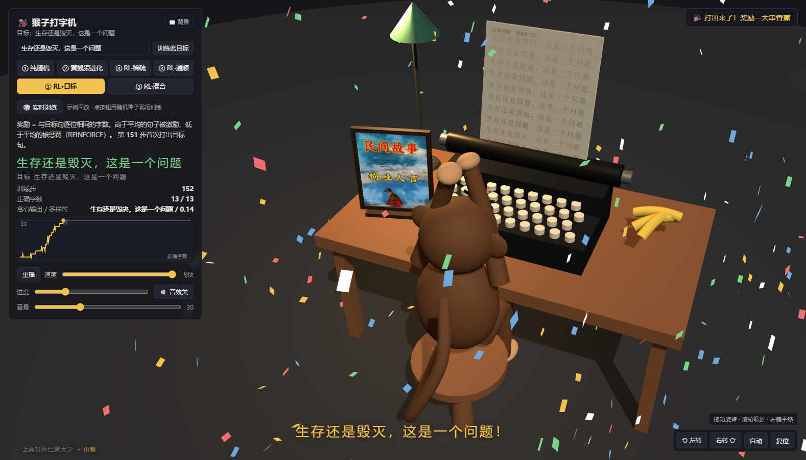
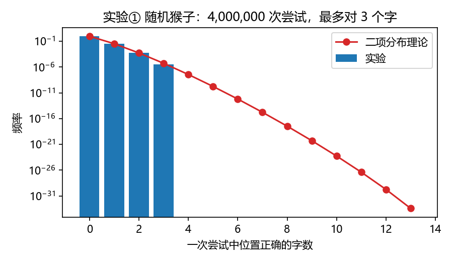
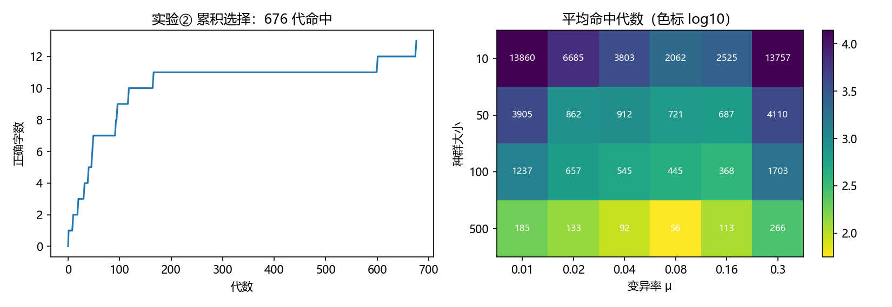
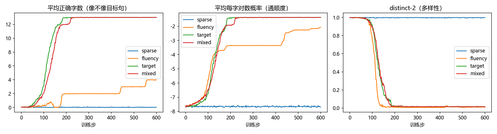
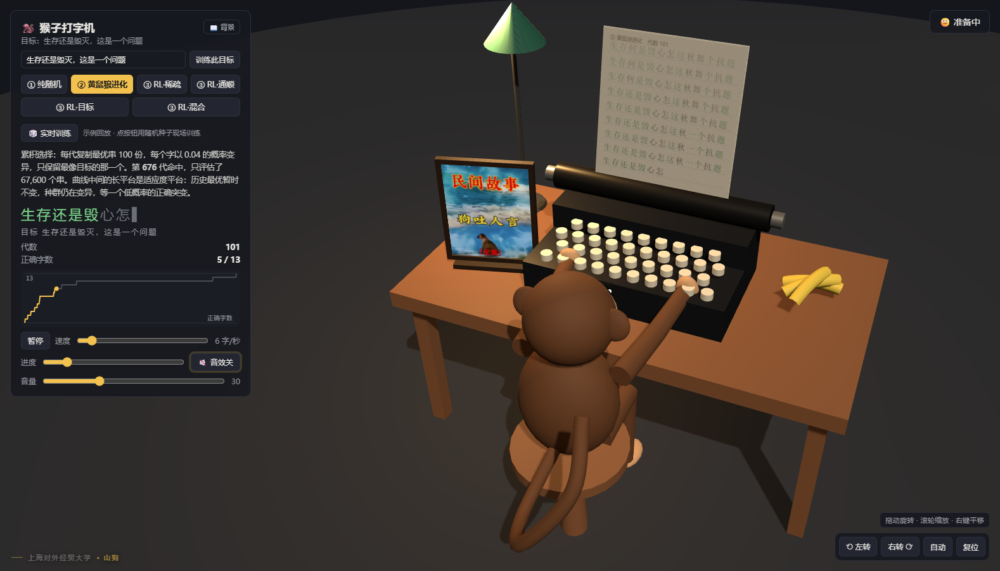
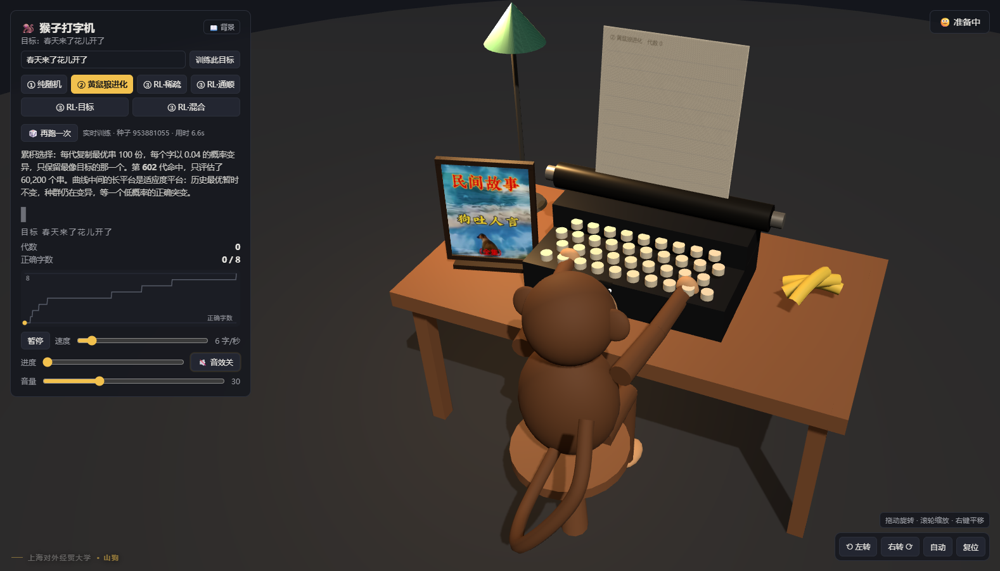

# 猴子打字机：随机、选择与强化学习

> 机器学习与机器算法课程项目。让一只猴子在打字机上敲出 **「生存还是毁灭，这是一个问题」**。
>
> 三条路线对照：**纯随机 → 累积选择（黄鼠狼程序）→ 强化学习（REINFORCE）**。配一个可交互的 Three.js 3D 打字机：默认逐帧回放实验日志，也可以点「🎲 实时训练」在浏览器里用新种子现场重跑。
>
> 第一次打开会先播一段背景开场：镜头转到侧面，文字从旁侧的黑背景里逐句浮现；之后可随时点「📖 背景」重看。
>
> **上海对外经贸大学 · 山狗**  
> 三分钟录屏演讲稿：[PRESENTATION_SEQ.md](PRESENTATION_SEQ.md)（先网站、后代码）  
> **GitHub 仓库**：<https://github.com/WAW689/monkey-type>

## 背景：从“无限猴子”说起

### 一个思想实验

这个项目的起点，是“无限猴子定理”：如果让一只猴子在打字机上随机敲键，只要时间足够长，它几乎必然会敲出莎士比亚的作品——包括《哈姆雷特》。这个思想实验通常追溯到法国数学家 Émile Borel 1913 年的文章；Arthur Eddington 在 1928 年的《物理世界的本质》里用“一群猴子敲打字机，或许能写出大英博物馆的所有藏书”的比喻，让它广为人知；Jorge Luis Borges 在 1939 年的《总图书馆》里又把它变成了一个关于“包含一切可能文本的图书馆”的文学意象。

它之所以迷人，是因为它把“概率”和“无限”放在了一起：一个看起来几乎不可能的事件，在无限次独立尝试下，发生的概率趋近于 1。

### 数学上“几乎必然”，物理上“几乎不可能”

设键盘有 V 个字符，目标句长 L。每次独立均匀地敲 L 下，命中目标的概率是 V<sup>-L</sup>；尝试 N 次，至少命中一次的概率是 1 − (1 − V<sup>-L</sup>)<sup>N</sup>，N → ∞ 时趋于 1；期望尝试次数是 V<sup>L</sup>。

这解释了定理，也暴露了它的“陷阱”：**几乎必然发生 ≠ 很快发生**。本项目里 V = 373、L = 13，V<sup>L</sup> ≈ 10<sup>33.4</sup>；即使每秒尝试 10 亿次，期望时间约 10<sup>24.4</sup> 秒，约 **620 万个宇宙年龄**。400 万次尝试连“对 3 个字”都算运气好。

所以“无限猴子”更适合作一把尺子：它给出了“没有任何反馈”的基线，接下来要问的是——加上反馈，能把这条指数曲线拉低多少？

### 从“等”到“选”：黄鼠狼程序

Richard Dawkins 在 1986 年的《盲眼钟表匠》里设计了一个著名的演示程序：目标串 `METHINKS IT IS LIKE A WEASEL`。

- **单步选择**：每一代都独立随机生成，概率不会因为“已经对了一些字”而提高；
- **累积选择**：保留当前最接近目标的串，只做少量随机变异，再保留更好的——那些“已经对了一点”的中间结果不会丢失。

这就是黄鼠狼程序，也是本项目实验②的原型。它把“从零开始的一次性抽奖”变成了“保留部分解的爬山”：指数搜索被压成了几十到几百代的阶梯。

### 从“选”到“学”：奖励设计

黄鼠狼程序的选择规则是人写的：逐位匹配数。强化学习进一步问：能不能让猴子从奖励里自己学出策略？

本项目的实验③用 REINFORCE 训练一个字符级策略，比较四种奖励：稀疏（只有整句完全正确才给分）、通顺（字符三元语言模型的打分）、目标（逐位匹配数）、混合（通顺 + 目标）。结果并不只是“学习让搜索更快”，还出现了更值得讲的现象：

- 稀疏奖励几乎学不动——没有中间信号，探索无从开始；
- 只奖励通顺会被“刷分”，收敛到重复的高频句式，出现 reward hacking 和模式坍缩；
- 混合奖励并不必然更好，甚至可能比纯目标奖励更不稳定——奖励塑形改变了优化地形。

### 这个项目要做什么

这个项目最初的想法，是把“无限猴子”从一个思想实验变成一个可以动手做、可以量化的课程项目。动机来自一个很自然的追问：既然定理说“迟早能打出来”，那能不能在课堂上真的看它打一次？如果不能，差在哪？如果加一点反馈，又能快多少？

选择中文，是因为按字建模的字符集只有 373 个（比英文单词词表小得多），目标句可以控制在 13 个字，既保留组合爆炸，又能在几秒到几十秒内跑完选择和学习的对照；字符级建模也正好连接到语言模型。

具体来说：

1. 用同一只“中文猴子”、同一个 13 字目标句，比较三种方法；
2. 用概率论给出随机基线，用遗传算法展示累积选择，用强化学习展示奖励驱动的学习；
3. 把实验日志做成可交互的 3D 打字机，并提供浏览器内的实时训练；
4. 用“命中所需尝试 / 代数 / 步数、困惑度、distinct-2”等指标，把“猴子离目标有多远”变成可测量的东西。

主线可以概括成一句话：**随机不可能，选择让它可能，学习让它高效；但奖励怎么设计，决定它到底学到什么。**

> 目标句：`生存还是毁灭，这是一个问题`（13 字）。《哈姆雷特》原句 “To be, or not to be, that is the question” 的朱生豪译本常作“生存还是毁灭，这是一个值得考虑的问题”；项目取更短的 13 字版本，便于把搜索空间和训练时间控制在可演示的范围。



## 结论先行

| 方法 | 结果 | 代价 |
|---|---|---|
| ① 纯随机 | 400 万次尝试，最多只对 **3** 个字 | 期望约 10³³ 次尝试；每秒 10 亿次也要 10^6.8 个宇宙年龄 |
| ② 累积选择 | **676** 代命中 | 约 6.8 万个候选串 |
| ③ RL · 目标奖励 | **151** 步命中，8/8 个种子都命中 | 约 9 700 个采样句 |
| ③ RL · 通顺奖励 | 没打出目标；坍缩成「他是一个是一个问是一个问。」 | 奖励被"刷分"，多样性几乎归零 |
| ③ RL · 稀疏奖励 | 完全学不动，输出仍是随机噪声 | 奖励几乎恒为 0，没有梯度信号 |
| ③ RL · 混合奖励 | 主实验 177 步命中，但 8 个种子里有 5 个 600 步仍未命中 | 奖励塑形反而更不稳定 |

一句话：**随机不可能，选择让它可能，学习让它高效；但奖励怎么设计，决定它到底学到什么。**

---

## 快速开始

```bash
# 0. 获取代码（也可以直接在 GitHub 下载 ZIP）
git clone https://github.com/WAW689/monkey-type.git
cd monkey-type

# 1. 安装依赖（只有两个）
py -m pip install -r requirements.txt

# 2. 跑全部实验：导出 web/data/results.json，并生成报告插图
py run_all.py            # 完整版，约 1~2 分钟
py run_all.py --quick    # 快速冒烟版（结果会覆盖完整版，正式出图请用完整版）

# 3. 启动可视化
py -m http.server 8765 -d web
# 浏览器打开 http://localhost:8765
```

> Windows 下用 `py`；macOS / Linux 把命令换成 `python3`。
> 不要直接双击 `web/index.html`：ES module 和 `fetch` 在 `file://` 下会被浏览器拦截，必须通过 HTTP 访问。
> 可视化不依赖外网：Three.js 和 OrbitControls 已经放在 `web/vendor/`。

---

## 项目结构

```text
monkey-type/
├─ monkey/                 实验代码
│  ├─ common.py            目标句、键盘字符表、字符三元语言模型、指标
│  ├─ exp1_random.py       ① 纯随机猴子
│  ├─ exp2_weasel.py       ② 黄鼠狼程序 + 参数扫描
│  └─ exp3_rl.py           ③ REINFORCE 强化学习猴子
├─ data/corpus.txt         通顺度模型的中文小语料（95 句）
├─ run_all.py              一键跑完 → results.json + 三张报告图
├─ PRESENTATION_SEQ.md     三分钟展示演讲稿（先网站、后代码）
├─ PRESENTATION.md         旧版：纯网站（备用）
├─ outputs/
│  ├─ figures/             报告插图 + 网页截图
│  └─ mixed_failures.json  混合奖励失败种子的诊断结果
├─ tools/
│  └─ diag_mixed.py        复现 mixed 失败种子的诊断脚本
└─ web/                    3D 可视化（Three.js，本地离线）
   ├─ index.html
   ├─ main.js
   ├─ train.js             浏览器内置的三个实验（Web Worker，实时训练）
   ├─ assets/dog-story.jpg  桌上 3D 相框里的图片
   ├─ data/results.json    示例回放数据（Python 版跑出来的固定结果）
   ├─ data/corpus.txt      实时训练用的中文小语料
   └─ vendor/              three.module.js / OrbitControls.js
```

---

## 实验设置

- **目标句**：`生存还是毁灭，这是一个问题`，长度 **13** 个字符（含中文逗号与句号）。
- **键盘**：`data/corpus.txt` 中出现过的字 ∪ 目标句的字，共 **373** 个字符。目标句中的每个字都可达。
- **语料**：95 句手写中文，主题围绕《哈姆雷特》、生存、选择、学习等。用来训练"通顺度"评分模型。
- **通顺度模型**：字符级三元语言模型（trigram / bigram / unigram / 均匀分布插值，权重 0.5 / 0.3 / 0.15 / 0.05）。
  目标句的困惑度约 **3.96**，说明模型认为它相当通顺。
- **统一指标**：
  - 命中所需尝试数 / 代数 / 训练步；
  - 正确字数（逐位匹配数，0–13）；
  - 困惑度（perplexity，越低越通顺）；
  - distinct-2（不同 bigram 数 / 总 bigram 数，越低越"模式坍缩"）。

> 注意：语料很小，语言模型很弱。它的作用是提供一个"通顺度"信号，而不是衡量真实中文的语法能力。结论主要看三种方法的对照，而不是绝对数值。

---

## 实验① 纯随机猴子：理论上可能，实际上不可能

每次从 373 个字的键盘上独立均匀地敲 13 下，没有任何反馈。

**理论**：搜索空间 `373^13 ≈ 10^33.4`。即使每秒尝试 10 亿次，期望时间约 `10^24.4` 秒，约 **6.2×10^6 个宇宙年龄**（宇宙年龄按 4.35×10¹⁷ 秒计）。

**实验**：400 万次尝试，最好的一次只对了 **3** 个字：
`消们还心考灭文死每读笔进题`。

命中字数分布与二项分布 `Binomial(13, 1/373)` 几乎重合：

| 正确字数 k | 实验次数 | 二项分布期望 |
|---:|---:|---:|
| 0 | 3 862 494 | 3 862 810 |
| 1 | 135 221 | 134 991 |
| 2 | 2 271 | 2 177 |
| 3 | 14 | 22 |
| ≥1 | 137 506（3.44%） | 137 190（3.43%） |



**解读**："无限猴子定理"说的是"无限时间下几乎必然发生"，不是"有限时间内可行"。400 万次已经很多，但离 10³³ 还差得远；分布与二项分布吻合，说明随机猴子确实是独立均匀采样，没有"越试越接近"这回事。

---

## 实验② 黄鼠狼程序：用累积选择把不可能变成几秒

每一代：

1. 以当前最优串为父本，复制 `pop` 份；
2. 每个字以概率 `mu` 变异成随机字；
3. 把父本和子代放在一起，只保留与目标句逐位匹配数最高的一个（精英保留）。

这样"对 3 个字"的中间结果不会被丢掉，搜索从"一步到位"变成"逐级爬山"。

**结果**（`pop=100, mu=0.04`）：第 **676** 代命中，共评估约 **6.76 万个**候选串。



**参数扫描**（每个格子是 5 次重复的平均命中代数；未命中的轮次按 20 000 代计）：

| 种群 \ 变异率 | 0.01 | 0.02 | 0.04 | 0.08 | 0.16 | 0.30 |
|---:|---:|---:|---:|---:|---:|---:|
| 10 | 13 860 | 6 685 | 3 803 | 2 062 | 2 525 | 13 757 |
| 50 | 3 905 | 862 | 912 | 721 | 687 | 4 110 |
| 100 | 1 237 | 657 | 545 | 445 | 368 | 1 703 |
| 500 | 185 | 133 | 92 | **56** | 113 | 266 |

三个可讲的点：

- **种群越大越稳**：`pop=500` 时最慢也只要 266 代；`pop=10, mu=0.01` 有 40% 的轮次在 20 000 代内没命中。
- **变异率有甜点**：太低（0.01）积累太慢，太高（0.30）会把已经积累的正确字又打乱。最佳在 `mu≈0.08`。
- **平台期**：适应度曲线在 11 个字处停了约 400 代。这不是卡死：HUD 显示的是历史最优，种群每代仍在生成 100 个变异体，但只有严格更优的个体才会替换父本。从 11 到 12 只需要把一个错误位置恰好变异成正确字符，但键盘有 373 个字符，这个“中奖”概率很低；失败或等价的变异都被丢弃，所以曲线是长平台 + 突然跳升。增加种群、适当提高变异率，或允许中性漂移，都能缩短平台。

---

## 实验③ 强化学习猴子：奖励设计决定它学到什么

### 策略与训练

- 策略：对数线性 softmax。第 `t` 位输出字符 `c` 的概率为
  `π(c | t, prev) = softmax(W_pos[t] + W_prev[prev])`。
  特征只有"位置"和"上一个字"，是一个很弱的策略，但足以演示奖励设计的影响。
- 算法：REINFORCE。每步采样 64 句，用批内标准化优势 `A = (R - mean(R)) / std(R)` 做策略梯度；
  加 0.01 的熵正则防止过早坍缩。
- 四种奖励：

| 模式 | 奖励 R | 想验证什么 |
|---|---|---|
| `sparse` | 只有整句完全等于目标才给 1 | 稀疏奖励能不能学？ |
| `fluency` | 三元语言模型的每字平均对数概率 | 只奖励"通顺"会怎样？ |
| `target` | 与目标句逐位相同的字数 | 有目标信号时多快？ |
| `mixed` | `fluency + 0.6 × 正确字数` | 加一点通顺度会不会更好？ |

### 主实验结果（600 步，每步 64 句）

| 模式 | 首次命中步 | 最终贪心输出 | 正确字数 | 困惑度 | distinct-2 |
|---|---:|---|---:|---:|---:|
| `sparse` | — | `。。。。。。。。。。。。。` | 0 | 76.6 | 0.999 |
| `fluency` | — | `他是一个是一个问是一个问。` | 4 | 7.9 | **0.009** |
| `target` | **151** | `生存还是毁灭，这是一个问题` | **13** | 4.0 | 0.016 |
| `mixed` | **177** | `生存还是毁灭，这是一个问题` | **13** | 4.0 | 0.016 |



**多种子复核**（600 步，命中即停）：

| 模式 | 8 个种子的命中步 | 命中率 | 均值 |
|---|---|---:|---:|
| `target` | 123, 117, 134, 151, 127, 161, 129, 132 | **8/8** | 134.2 |
| `mixed` | —, —, 181, 177, 168, —, —, — | 3/8 | — |

### 四个现象

1. **稀疏奖励学不动。** 整句完全正确的概率约 `(1/373)¹³`，600 步内几乎不可能采样到。奖励恒为 0 → 优势恒为 0 → 没有梯度；熵正则把策略推向均匀分布，贪心输出退化成 13 个「。」。
   这就是"探索问题"：没有中间信号，学习无从开始。

2. **只奖励通顺 → reward hacking + 模式坍缩。** 猴子确实学会了"说人话"：困惑度从 76.6 降到 7.9。
   但它找到的是一个高频、重复、容易拿分的局部最优——「他是一个是一个问是一个问。」——而不是哈姆雷特。
   同时 distinct-2 从 0.997 掉到 **0.009**：整批采样几乎一模一样，多样性消失。这正好对应课程里的两个概念：
   **奖励黑客**（优化了代理指标，而不是真正目标）和**模式坍缩**（policy 退化成少数几个模式）。

3. **目标奖励非常有效。** 151 步（约 9 700 个采样句）命中，8 个种子全部命中，命中步集中在 117–161。
   采样量只有实验②的约 **1/7**（9 664 vs 67 600 次评估）——因为梯度把"哪个字错了"的信息分配到了具体位置上，而不是盲目变异。

4. **混合奖励反而更不稳定（反直觉）。** 主实验 177 步命中，但 8 个种子里只有 3 个在 600 步内命中；失败的种子停在 9–11 个字（如 `生存的是毁灭，这是一个学题`），困惑度 5.0–13.6，并非"更通顺的错句"。
   一个合理解释是：通顺度梯度会把策略拉向高频字和常见句式，与"精确复制目标句"竞争，形成局部最优；`target` 的奖励地形更干净。
   这提醒我们：**奖励塑形（reward shaping）不是免费的午餐，加一项看似合理的目标，可能让优化更难。**

> 需要诚实说明：`mixed` 的失败是在 600 步预算下观察到的；训练更久可能会命中。这里的结论是"在同等预算下，目标奖励更可靠"，而不是"混合奖励永远学不会"。

---

## 三种方法横向对比

| 方法 | 需要的反馈 | 命中代价 | 特点 |
|---|---|---|---|
| ① 纯随机 | 无 | 期望 10³³ 次尝试 | 证明"有限时间不可行" |
| ② 累积选择 | 逐位匹配数 | 约 6.8 万个候选串 | 实现简单、稳定；靠种群和变异率调参 |
| ③ RL · target | 逐位匹配数 | 约 9 700 个采样句 | 样本效率最高；需要策略梯度实现 |
| ③ RL · fluency | 语言模型打分 | 永远打不出目标 | 展示奖励黑客与模式坍缩 |
| ③ RL · mixed | 两者加权 | 3/8 种子在 600 步内命中 | 展示奖励塑形的副作用 |

**怎么读这张表**：RL 的"采样句数"少，但每一步要算 64 句的 softmax、语言模型打分和梯度，单步成本比遗传算法高；所以"样本效率"和"墙钟时间"是两回事。课程报告里可以把两者分开讨论。

---

## 3D 可视化

浏览器打开后，左边是 HUD，右边是 3D 场景：一只由基本几何体拼成的猴子坐在打字机前，旁边有台灯、香蕉和纸。猴子**面向桌子**，双臂前伸，双手落在键盘上；默认相机在猴子的后上方，是一个"操作者"视角，能同时看到双手和键盘。



**功能**

- **背景开场**：第一次打开时，镜头转到侧面，开场文字在左侧的黑背景中逐句浮现；读过的句子沉入黑色，当前句亮起。点击画面继续、`Esc` 关闭，底部可以重播或直接进入演示；之后随时可以点 HUD 里的「📖 背景」重看。
- **六个标签页**：① 纯随机、② 黄鼠狼进化、③ RL·稀疏 / 通顺 / 目标 / 混合。切换即换实验。
- **自定义目标**：HUD 顶部输入 4–20 个字，点「训练此目标」；目标里的新字会自动加入键盘，语料外的字也能打，但通顺度评分会偏低。示例回放仍是固定目标，自定义目标走实时训练；目标越长，RL 步数自动增加（13 字 300 步，20 字 475 步）。自定义目标只在浏览器实时训练里生效，`run_all.py` 生成的报告数据仍用默认目标。
- **逐字打字**：每个回放帧是一行日志（一次尝试、一代、或一个训练步）；猴子一个字一个字敲，纸面上绿色=位置正确，灰色=不正确。
- **实时分数**：正确字数、训练步/代数、贪心输出、distinct-2。
- **奖励/惩罚反馈**：比上一帧进步 → 点头、举香蕉、顶部"🍌 激励！"；退步 → 摇头、皱眉、"⚡ 惩罚！"；命中目标 → 起立欢呼、撒彩纸、显示"生存还是毁灭，这是一个问题！"。
- **曲线**：底部画当前实验的正确字数随进度变化，金色高亮已播放部分。
- **自由视角**：鼠标左键拖动旋转（水平 360°）、滚轮缩放、右键平移；右下角还有 **左转 / 右转 / 自动 / 复位** 四个按钮，"自动"会让相机缓慢环绕，方便转到侧面或正面看猴子的表情。
- **音效**：全部用 Web Audio 实时合成，不依赖音频文件。敲字是低通的木质轻响；每行得分上升/下降有柔和提示音；命中目标播放温暖的上行和弦；整段跑完仍未命中播放低频下行"失败"音。整体经过低通处理，避免高频刺耳。HUD 进度条右侧的 **🔇 音效关 / 🔊 音效开** 开关控制；每次打开默认静音，点一下开启，开启时会先响两声"叮"作为试听；下面的 **音量** 滑块默认 30，觉得小可以拉到 100。
- **水印**：页面左下角与打字机纸张页脚都有「上海对外经贸大学 · 山狗」的个人水印。
- **桌面相框**：桌子左侧有一个 3D 木相框，里面是 `web/assets/dog-story.jpg`；尺寸按图片比例自适应（最大 0.38×0.50），不会拉伸变形。
- **控制**：暂停/继续、速度滑块（1–60，默认 6 字/秒，超过 40 后加速到"飞快"）、进度条拖动。
- **重播**：一次实验播完后按钮变成"重播"，点击从头开始。




**三种入口**：默认用 `run_all.py` 生成的 `results.json` 做**示例回放**；点 HUD 里的「🎲 实时训练」则在浏览器里**现场重跑**（见下一节）；在顶部输入自定义目标后点「训练此目标」，会用这个目标重跑三个实验。示例回放的好处：

- 打开网页不需要等训练，几秒就能看完整个实验；
- 结果可复现（固定随机种子），网页展示的就是报告里的数据；
- Three.js 全部本地化，断网也能用。

**已验证**：在 Chrome headless（SwiftShader）下加载，控制台无报错；六个标签页、拖动旋转、滚轮缩放、自动环绕、复位、背景开场（逐句浮现 / 已读变黑 / 镜头切换与恢复）、桌面相框、命中庆祝、"重播"、音效开关（敲击 / 成功 / 失败触发）均验证正常；实时训练连续跑两次得到不同的种子、黄鼠狼代数和 RL 命中步，训练完成后自动替换数据并播放；自定义目标分别用 8 字和 20 字验证了输入、训练、纸张排版与分数。

### 实时训练（浏览器内置）

页面打开时先用 `results.json` 做示例回放；点 HUD 里的 **🎲 实时训练**，会在 Web Worker 里用新的随机种子把三个实验重跑一遍（① 随机 400 万次、② 黄鼠狼、③ RL 四种奖励各 300 步，目标更长时自动加到最多 475 步），完成后自动替换数据并播放。自定义目标也走同一条链路：输入 4–20 字，目标中的新字会加入键盘，语料外的字通顺度评分会偏低。

- 每次种子不同 → 黄鼠狼的代数、RL 的命中步、曲线、混合奖励的成败都会不同；
- 不输入自定义目标时，成功时打出默认的「生存还是毁灭，这是一个问题」；自定义目标则打出输入的目标，变化的是**过程**和**目标句**；
- 训练期间 3D 画面暂停，HUD 显示「①/②/③ 进度」，完成后显示种子和用时；
- 不依赖 Python / Pyodide：`web/train.js` 就是内置的学习代码，纯静态网页即可运行；
- 与 Python 版的差异：JS 用 mulberry32 随机数、RL 默认 300 步（长目标最多 475 步；报告版 600 步），所以数字不会和报告一一对应，算法是一致的；报告数据仍以 `run_all.py` 为准；
- 刷新页面回到示例回放；实时结果只存在内存里，不写回 `results.json`。

训练时间取决于 CPU，桌面浏览器默认目标通常几秒到十几秒；headless + SwiftShader 的测试环境约 9–14 秒，20 字目标约 18 秒。

---

## 课程报告可以怎么讲

建议主线：**随机不可能 → 选择让它可能 → 学习让它高效 → 奖励设计决定它学到什么。**

| 报告章节 | 用到的材料 | 想说明的问题 |
|---|---|---|
| 1. 问题与基线 | 实验①、二项分布表 | 组合爆炸；"无限"不是"可行" |
| 2. 累积选择 | 实验②、热力图 | 为什么保留中间结果能把指数搜索变成阶梯搜索；种群/变异率如何权衡 |
| 3. 策略梯度 | 实验③ target 曲线 | REINFORCE 如何把奖励分配到每个字符位置；为什么比盲目变异省样本 |
| 4. 奖励设计 | sparse / fluency / mixed | 稀疏奖励、奖励黑客、模式坍缩、奖励塑形的副作用 |
| 5. 工程与可视化 | 3D 网页 | 如何把实验日志变成可交互的教学演示 |
| 6. 局限与展望 | 见下节 | 语料小、策略弱、单目标句 |

**可以引导课堂讨论的问题**

- 为什么"只奖励通顺"的猴子会重复「他是一个是一个问是一个问。」？它错在哪？
- 如果奖励改成"编辑距离"或"逐位匹配数的平方"，会有什么不同？
- 为什么 `mixed` 反而不如 `target`？这是实现问题，还是奖励设计问题？
- 遗传算法和强化学习，谁更"聪明"？"样本效率"和"计算效率"如何区分？
- 如果目标句换成 50 个字，三种方法分别会怎样？

---

## 局限与可扩展方向

**局限**

- 语料只有 95 句，三元语言模型很弱；"通顺度"只在这个小世界里有效。
- 策略特征只有"位置 + 上一个字"，不能建模长距离依赖；命中 13 字的目标已经接近它的能力边界。
- 只测了一个目标句；主实验每个模式只跑了一个种子（多种子只覆盖 `target` / `mixed`）。
- `mixed` 的失败是 600 步预算内的观察，不能推断"永远学不会"。
- 没有做严格的显著性检验；参数扫描每个格子只有 5 次重复。

**可以接着做**

1. 用 PPO / A2C 替换 REINFORCE，比较稳定性；
2. 把策略换成字符级 GRU / 小 Transformer，看能否处理更长目标；
3. 奖励改成编辑距离、最长公共子序列，或"命中字数 + 位置惩罚"；
4. 课程学习：先学长度 3 的句子，再逐步加长；
5. 多目标句训练，观察策略是否会"串味"；
6. 把 3D 网页做成课堂演示：加自定义目标句、奖励曲线叠加、多个猴子赛跑。

---

## 复现细节

- **随机种子**：实验① `seed=1`；实验② `seed=2`，参数扫描 `seed=100+repeat`；实验③主实验 `seed=3`，多种子 `seed=0..7`。
- **可复现性**：全部用 `numpy.random.default_rng(seed)`，相同环境下结果一致（浮点运算可能有末位差异）。
- **数据流**：`run_all.py` → `web/data/results.json`（约 720 KB）+ `web/data/corpus.txt` + `outputs/figures/*.png`。
- **实时训练**：`web/train.js` 在 Web Worker 里用 `crypto.getRandomValues` 取种子，HUD 显示种子和用时；结果只存在内存里，刷新即回到示例回放。
- **`results.json` 结构**：
  - 顶层：`target`, `vocab_size`, `vocab`, `exp1`, `exp2`, `exp3`, `exp3_seeds`；
  - `exp1.history[]`：`attempt`, `best`, `sample`；
  - `exp2.history[]`：`gen`, `best`, `fitness`；`exp2.sweep[]`：`pop`, `mu`, `mean_gen`, `hit_rate`；
  - `exp3[mode].history[]`：`step`, `reward`, `fluency`, `match`, `best`, `greedy`, `distinct2` 等；
  - `exp3_seeds`：每种模式的命中步列表（`null` 表示未命中）。
- **抽稀**：Python 版写 `results.json` 时只保留 200–400 个历史点（保留首尾）；实时版每 2 步记录一次，默认目标 300 步，长目标最多 475 步。
- **浏览器要求**：支持 ES module + WebGL 的现代浏览器（Chrome / Edge / Firefox / Safari 均可）。已在 Chrome（headless + SwiftShader）验证。
- **诊断脚本**：`tools/diag_mixed.py` 可复现 `mixed` 失败种子的最终输出，结果在 `outputs/mixed_failures.json`。

---

## 依赖

```text
numpy>=1.24
matplotlib>=3.7
```

网页端：Three.js 0.160（MIT），已放在 `web/vendor/`，无需 npm。

测试环境：Windows 11 + Python 3.13 + numpy 2.3.5 + matplotlib 3.10.6。

---

## 参考文献

1. Émile Borel, *Mécanique statistique et irréversibilité*, Journal de Physique, 1913；相关通俗论述见 *Le Hasard*, 1914.
2. Arthur Eddington, *The Nature of the Physical World*, 1928.
3. Jorge Luis Borges, "The Total Library" (1939); "The Library of Babel" (1941).
4. Richard Dawkins, *The Blind Watchmaker*, 1986.
5. Richard S. Sutton and Andrew G. Barto, *Reinforcement Learning: An Introduction*, 2nd ed., MIT Press, 2018.
6. William Shakespeare, *Hamlet*, Act 3, Scene 1；朱生豪译.

> 关于“无限猴子”思想实验的具体表述，不同文献有不同版本；本文取其核心：无限次独立随机尝试下，任何有限文本几乎必然出现。

---

## 说明

- 作者：**上海对外经贸大学 山狗**。
- 代码仅用于课程学习与演示。
- `data/corpus.txt` 为手写小语料；《哈姆雷特》原文及朱生豪译本已进入公有领域，可自行追加更大语料。
- Three.js 遵循 MIT 许可证。
